<div align="center">


# VogChat Crypto

**The end-to-end encryption behind [VogChat](https://vogchat.com): private chat rooms with no account and no phone number.**

<sub>Open-source cryptographic component · not independently audited</sub>

[](https://github.com/vogchat/vogchat-crypto/actions/workflows/test.yml)
[](https://github.com/vogchat/vogchat-crypto/actions/workflows/live-check.yml)
[](LICENSE)
[](https://www.w3.org/TR/WebCryptoAPI/)
[](package.json)

[Whitepaper](WHITEPAPER.md) · [Verify it yourself](#verify-it-yourself) · [Security policy](SECURITY.md) · [vogchat.com](https://vogchat.com)

<br>

<picture>
  <source media="(prefers-color-scheme: dark)" srcset="docs/assets/e2e-flow-dark.svg">
  
</picture>

</div>

## Why this exists

VogChat says the server **cannot read your messages**. A claim like that should be checkable, not trusted.

This repository contains the exact encryption code that runs on [vogchat.com](https://vogchat.com) and inside the VogChat iPhone app, with a test suite, an independent reference implementation, and a [whitepaper](WHITEPAPER.md) that describes the design and its limits. A [daily check](.github/workflows/live-check.yml) confirms that the live site serves this file byte for byte.

## How it works

1. Friends agree on a **room code** and a **room password**.
2. Each device stretches the password with **PBKDF2-SHA-256** (300,000 iterations, room code as salt) and splits the result with **HKDF** into two keys:
   - `authKey` proves to the server that you know the password. The server only stores an Argon2id hash of it.
   - `encKey` encrypts messages. **It never leaves the device.**
3. Messages, photos, voice messages, documents, reply quotes, meeting times and call setup are encrypted with **AES-256-GCM** and a fresh random IV. Content is relayed in real time and never stored; meeting times are kept, encrypted, for up to 3 days so friends who come online later still see them. Calls are encrypted with DTLS-SRTP, and their setup (including the certificate fingerprints) goes through the room encryption above, so the server cannot intercept them. Details in the [whitepaper](WHITEPAPER.md).

```text
master  = PBKDF2-SHA256(NFKC(password), "vogchat-e2e-v1|" + ROOMCODE, 300000)
authKey = HKDF-SHA256(master, info = "vogchat-e2e-v1|auth")   → sent to the server
encKey  = HKDF-SHA256(master, info = "vogchat-e2e-v1|enc")    → stays on the device
message = base64url(iv[12] || AES-256-GCM(encKey, iv, text))
```

The whole implementation is [70 lines](src/crypto.js) on top of the browser's built-in WebCrypto API. No custom cryptography, no dependencies.

## Verify it yourself

```bash
git clone https://github.com/vogchat/vogchat-crypto.git
cd vogchat-crypto
npm test              # 14 tests, needs Node.js 20+
npm run verify-live   # compares vogchat.com/crypto.js with src/crypto.js
```

The tests load `src/crypto.js` **unchanged**, the way a browser does, and check it against:

- **known-answer vectors** that pin the key derivation,
- an **independent re-implementation** built on Node's own crypto library (not WebCrypto),
- an **independent AES-256-GCM decryptor**,
- tampering, truncation, wrong passwords, IV reuse and key export.

## API

`src/crypto.js` is a plain browser script that exposes `window.vogCrypto`:

| Function | Description |
| --- | --- |
| `available()` | `true` when WebCrypto is usable (a secure context). |
| `deriveKeys(roomCode, password)` | `{ authKey, encKeyRaw }`, both 32 bytes, base64url. |
| `importKey(encKeyRaw)` | Imports the encryption key as a non-extractable AES-GCM `CryptoKey`. |
| `encrypt(key, text)` | `base64url(iv ‖ ciphertext ‖ tag)` |
| `decrypt(key, payload)` | The original text. Throws if anything was changed. |

## Security at a glance

| | |
| --- | --- |
| ✅ Server cannot read content | Only ciphertext and a hash of `authKey` reach it. |
| ✅ No message storage | Messages are relayed in real time and never written to disk. |
| ✅ Tamper-evident | AES-GCM rejects any modified message. |
| ✅ Standard primitives | PBKDF2, HKDF, AES-GCM from WebCrypto. |
| ⚠️ Strength depends on the password | Short passwords can be guessed offline by someone who controls the server. New rooms need 6+ letters. |
| ⚠️ No replay protection yet | A malicious server could re-deliver an old ciphertext. It cannot forge or alter one. |
| ⚠️ No forward secrecy yet | One key per room. |
| ⚠️ Some metadata is visible | Nicknames, reactions, and who is online when. |
| ⚠️ Not yet audited | No independent audit so far. |

The [whitepaper](WHITEPAPER.md) explains each of these in detail, with a full threat model and data retention table.

## Repository layout

```text
src/crypto.js            the code vogchat.com and the iOS app run (do not reformat: verified byte for byte)
test/crypto.test.js      known-answer, cross-implementation and tamper tests
scripts/verify-live.js   compares the live site with this repository
WHITEPAPER.md            design, threat model, retention, limitations, roadmap
```

## Roadmap

- Stronger room passwords (strength hint, longer passphrases)
- Replay protection (authenticated message ids and timestamps)
- Open-sourcing the web client, then the iOS app
- Encrypting nicknames and reactions
- Forward secrecy, evaluated on top of MLS
- An independent security audit, published here

## Reporting a vulnerability

Please **do not** open a public issue for security problems. Use GitHub's [private vulnerability reporting](https://github.com/vogchat/vogchat-crypto/security/advisories/new). Details are in [SECURITY.md](SECURITY.md).

## License

[Apache License 2.0](LICENSE)
