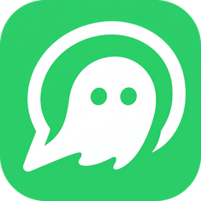

<div align="center">



# VogChat Crypto

**The end-to-end encryption behind [VogChat](https://vogchat.com): private chat rooms with no account and no phone number.**

<sub>Open-source cryptographic component</sub>

[](https://github.com/vogchat/vogchat-crypto/actions/workflows/test.yml)
[](https://github.com/vogchat/vogchat-crypto/actions/workflows/live-check.yml)
[](LICENSE)
[](https://www.w3.org/TR/WebCryptoAPI/)
[](package.json)

[Whitepaper](WHITEPAPER.md) · [Verify it yourself](#verify-it-yourself) · [Security policy](SECURITY.md) · [vogchat.com](https://vogchat.com)

<br>

<picture>
  <source media="(prefers-color-scheme: dark)" srcset="docs/assets/e2e-flow-dark.svg">
  
</picture>

</div>

## Why this exists

VogChat says the server **cannot read your messages**. A claim like that should be checkable, not trusted.

This repository contains the exact encryption code that runs on [vogchat.com](https://vogchat.com) and inside the VogChat iPhone app, with a test suite, an independent reference implementation, and a [whitepaper](WHITEPAPER.md) that describes the design and its limits. A [daily check](.github/workflows/live-check.yml) confirms that the live site serves this file byte for byte.

## How it works

1. Friends agree on a **room code** and a **room password**.
2. Each device stretches the password with **PBKDF2-SHA-256** (300,000 iterations, room code as salt) and splits the result with **HKDF** into two keys:
   - `authKey` is sent to the server at each login to prove that you know the password. The server stores only an Argon2id hash of it, and `authKey` does not reveal `encKey`.
   - `encKey` encrypts messages. **It never leaves the device.**
3. Messages, photos, voice messages, documents, reply quotes, meeting times and call setup are encrypted with **AES-256-GCM** and a fresh random IV. Content is relayed in real time and never stored; meeting times are kept, encrypted, for up to 3 days so friends who come online later still see them. Calls are encrypted with DTLS-SRTP, and their setup (including the certificate fingerprints) goes through the room encryption above, so the server cannot intercept them. Details in the [whitepaper](WHITEPAPER.md).

```text
master  = PBKDF2-SHA256(NFKC(password), "vogchat-e2e-v1|" + ROOMCODE, 300000)
authKey = HKDF-SHA256(master, info = "vogchat-e2e-v1|auth")   → sent to the server
encKey  = HKDF-SHA256(master, info = "vogchat-e2e-v1|enc")    → stays on the device
message = base64url(iv[12] || AES-256-GCM(encKey, iv, text))
```

The whole implementation is [70 lines](src/crypto.js) on top of the browser's built-in WebCrypto API. No custom cryptography, no dependencies.

## Verify it yourself

```bash
git clone https://github.com/vogchat/vogchat-crypto.git
cd vogchat-crypto
npm test              # 14 tests, needs Node.js 20+
npm run verify-live   # compares vogchat.com/crypto.js with src/crypto.js
```

The tests load `src/crypto.js` **unchanged**, the way a browser does, and check it against:

- **known-answer vectors** that pin the key derivation,
- an **independent re-implementation** built on Node's own crypto library (not WebCrypto),
- an **independent AES-256-GCM decryptor**,
- tampering, truncation, wrong passwords, IV reuse and key export.

## API

`src/crypto.js` is a plain browser script that exposes `window.vogCrypto`:

| Function | Description |
| --- | --- |
| `available()` | `true` when WebCrypto is usable (a secure context). |
| `deriveKeys(roomCode, password)` | `{ authKey, encKeyRaw }`, both 32 bytes, base64url. |
| `importKey(encKeyRaw)` | Imports the encryption key as a non-extractable AES-GCM `CryptoKey`. |
| `encrypt(key, text)` | `base64url(iv ‖ ciphertext ‖ tag)` |
| `decrypt(key, payload)` | The original text. Throws if anything was changed. |

## Security at a glance

| | |
| --- | --- |
| ✅ Server cannot read content | Only ciphertext and a hash of `authKey` reach it. |
| ✅ No message storage | Messages are relayed in real time and never written to disk. |
| ✅ Tamper-evident | AES-GCM rejects any modified message. |
| ✅ Sender bound to each message | The sender's member id and nickname are inside the encryption, so the server cannot relabel a message. |
| ✅ Standard primitives | PBKDF2, HKDF, AES-GCM from WebCrypto. |
| ⚠️ Strength depends on the password | Short passwords can be guessed offline by someone who controls the server. New rooms need 6+ letters. |
| ⚠️ No replay protection yet | A malicious server could re-deliver an old ciphertext. It cannot forge or alter one. |
| ⚠️ One key per room | No forward secrecy yet, but nothing is kept to decrypt later: no message storage, traffic inside TLS, and the owner can change the password (and key) at any time. |
| ⚠️ Some metadata is visible | Nicknames, reactions, and who is online when. |

The [whitepaper](WHITEPAPER.md) explains each of these in detail, with a full threat model and data retention table.

## Common questions

**If someone learns a room password later, can they read old messages?**
Only if they had recorded the encrypted traffic at the moment it was sent. VogChat keeps no messages: the server relays them in real time and never writes them to storage, and the apps hold them in memory only, so they are gone when you leave the room or reload the page. The traffic itself also runs inside TLS (HTTPS / secure WebSocket). There is no message archive that we, or anyone who breaks into the server later, could hand over. Use a strong password (new rooms need 6+ letters); the room owner can change the password at any time, which moves the room to a new key.

**Are open rooms private?**
No, and the app says so before you join. Open rooms are public rooms for meeting new people: their password is given to the server so that anyone can join, which means anyone, the server included, can read them. For a private conversation, open a private room with your own password. That password never reaches the server.

**Can the server make a message look like it came from someone else?**
No. Every encrypted message carries its sender's member id and nickname *inside* the encryption, and the apps check them against what the server reports; a message that does not match is not shown. The server also cannot read, change or create messages. What encryption cannot stop: everyone who knows the room password shares the same key, so a member can pick any nickname. Share the password only with people you trust.

**What do you keep?**
No messages, photos, voice messages, documents or calls. A room keeps its code and a hash of the login key until it closes. If you leave a meeting time, it can carry a short note (at most 80 characters, at most 15 per room); it is stored encrypted and deleted after 3 days. Network addresses are used only in hashed form for rate limits, for up to an hour. The full table is in the [whitepaper](WHITEPAPER.md#8-metadata-and-data-retention).

**Why VogChat and not Signal?**
Signal is an excellent messenger. VogChat is for a different moment: talking with someone **without giving them your phone number**, without an account, from any browser or the iPhone app, in a room you can close for good. The encryption that protects your messages is open here, tested, and checked against the live site every day.

## Repository layout

```text
src/crypto.js            the code vogchat.com and the iOS app run (do not reformat: verified byte for byte)
test/crypto.test.js      known-answer, cross-implementation and tamper tests
scripts/verify-live.js   compares the live site with this repository
WHITEPAPER.md            design, threat model, retention, limitations, roadmap
```

## Roadmap

- Stronger room passwords (strength hint, longer passphrases)
- Replay protection (authenticated message ids and timestamps)
- Open-sourcing the web client, then the iOS app
- Encrypting nicknames and reactions
- Forward secrecy, evaluated on top of MLS

## Reporting a vulnerability

Please **do not** open a public issue for security problems. Use GitHub's [private vulnerability reporting](https://github.com/vogchat/vogchat-crypto/security/advisories/new). Details are in [SECURITY.md](SECURITY.md).

## License

[Apache License 2.0](LICENSE)
