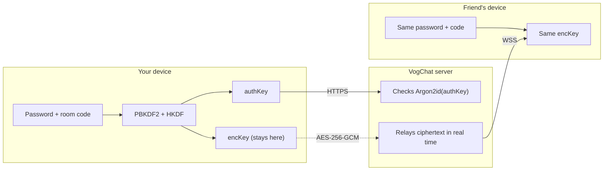

# VogChat Security Whitepaper

**Version 1.2 · October 2026 · Protocol `vogchat-e2e-v1`**

This document describes how VogChat protects conversations: what is encrypted, how the keys are made, what the server can and cannot see, and where the protection ends. It is written for security researchers and for anyone who wants to check our claims instead of trusting them.

Everything here can be verified against the code in this repository ([`src/crypto.js`](src/crypto.js)) and the tests in [`test/`](test/). If you find a difference between this document and the code, the code is what runs, and we want to hear about it (see [SECURITY.md](SECURITY.md)).

> **Status:** open-source cryptographic component, **not independently audited**. Only the encryption module is open; the server and the app clients are not (yet), so some statements about them cannot be verified from this repository alone. This whitepaper and the open code are the first step towards an audit.

---

## Contents

1. [Overview](#1-overview)
2. [Architecture](#2-architecture)
3. [Cryptographic design](#3-cryptographic-design)
4. [Key management](#4-key-management)
5. [Room access and invitations](#5-room-access-and-invitations)
6. [What is encrypted, and what is not](#6-what-is-encrypted-and-what-is-not)
7. [Threat model](#7-threat-model)
8. [Metadata and data retention](#8-metadata-and-data-retention)
9. [Known limitations](#9-known-limitations)
10. [Verification](#10-verification)
11. [Roadmap](#11-roadmap)

---

## 1. Overview

VogChat is a chat app built around **rooms** instead of accounts. A room is identified by an 8-character **room code** and protected by a **room password** that the people in it choose and share with each other. There is no sign-up, no phone number and no e-mail address.

**Design goals**

- The server relays messages but **cannot read them**.
- Nobody needs an account or a phone number to talk.
- **Message content is never written to storage** on the server.
- The encryption uses only standard, widely reviewed primitives available in every browser (WebCrypto), with no custom cryptography.

**Non-goals (today)**

- Protection against people who are *in* the room: anyone who knows the room code and password is a full participant.
- Hiding *that* two people talk (traffic analysis) from the server operator.
- Forward secrecy (see [section 9](#9-known-limitations)).

## 2. Architecture



| Component | Role |
| --- | --- |
| **Web client** (vogchat.com) | Runs in the browser. Loads [`crypto.js`](src/crypto.js) from vogchat.com and uses the browser's built-in WebCrypto. |
| **iOS app** | Native app. Runs the *same* `crypto.js` inside an invisible system WebView, so the iPhone uses the platform's native WebCrypto implementation and exactly the code in this repository. |
| **Server** | A Go service behind TLS. Creates rooms, checks room logins, and relays WebSocket messages between the people in a room. It never receives the room password or the encryption key. |
| **Call relay (TURN)** | Our own relay in the EU, used only when two devices in a call cannot reach each other directly. It forwards encrypted call media (section 6.1) and keeps no call logs. Connection setup (STUN) also uses only our own server. |

All traffic between clients and the server uses TLS (HTTPS and WSS). End-to-end encryption is applied *inside* that, so the content stays encrypted even where TLS ends: on the server itself.

## 3. Cryptographic design

All primitives come from the standard [Web Cryptography API](https://www.w3.org/TR/WebCryptoAPI/).

| Purpose | Primitive | Parameters |
| --- | --- | --- |
| Stretch the password | PBKDF2-HMAC-SHA-256 | 300,000 iterations, 256-bit output |
| Separate the keys | HKDF-SHA-256 | 32 zero bytes as salt, labelled `info` |
| Encrypt content | AES-256-GCM | 96-bit random IV per message, 128-bit tag |
| Encoding | base64url | no padding |

### 3.1 Key derivation

```
salt     = UTF-8("vogchat-e2e-v1|" + upper(roomCode))
master   = PBKDF2-SHA256(NFKC(password), salt, 300000 iterations, 32 bytes)
authKey  = HKDF-SHA256(master, salt = 0x00 * 32, info = "vogchat-e2e-v1|auth", 32 bytes)
encKey   = HKDF-SHA256(master, salt = 0x00 * 32, info = "vogchat-e2e-v1|enc",  32 bytes)
```

- **The room code is the salt.** The same password in two different rooms gives unrelated keys, so a precomputed table for one room is useless for another.
- **The password is normalised with Unicode NFKC** before use, so the same word typed on different keyboards (for example a precomposed `Ç` and a `C` with a combining cedilla) gives the same key. The password stays **case-sensitive**.
- **HKDF splits one secret into two independent keys.** `authKey` is shown to the server to prove knowledge of the password; `encKey` encrypts content. Knowing `authKey` does not reveal `encKey`, because HKDF outputs with different labels are computationally independent.
- The version string `vogchat-e2e-v1` is part of every derivation, so a future protocol version cannot be confused with this one.

### 3.2 Encryption

```
iv         = 12 random bytes (crypto.getRandomValues)
ciphertext = AES-256-GCM(encKey, iv, UTF-8(plaintext))   // includes the 16-byte tag
payload    = base64url(iv || ciphertext)
```

- A **fresh random IV** is drawn for every message. With 96-bit random IVs, the probability of a repeat stays negligible far beyond the number of messages a room realistically sends.
- GCM is **authenticated encryption**: any change to the IV, ciphertext or tag makes decryption fail. The server cannot alter a message without the change being detected.
- The `CryptoKey` used for encryption is imported as **non-extractable**, so it cannot be exported back out of WebCrypto. Note that `deriveKeys()` itself returns the raw key bytes (`encKeyRaw`) as a string to the client, which imports them right away; see [section 4](#4-key-management) for where the raw value is kept.

## 4. Key management

| Key | Created | Where it lives | Leaves the device? |
| --- | --- | --- | --- |
| Room password | Chosen by the room's creator | In the people's heads; optionally on the device (below) | Only as the user shares it themselves |
| `encKey` | Derived on the device at login | In memory as a non-extractable `CryptoKey`. On the web, the raw key and the password are also kept in the tab's `sessionStorage` while the room is open, so a page reload can resume; they are cleared when you leave the room. | **Never** |
| `authKey` | Derived on the device at login | Sent once per login | To the server, which stores only an Argon2id hash of it |
| Owner key | 32 random bytes, made on the device that creates the room | That device's storage (`localStorage` on the web) | Sent to prove ownership when the owner opens the room; the server stores only a keyed hash (HMAC-SHA-256). It is not derived from the password and gives no access to content. |

**Remembered rooms.** Users can choose "Remember this room" so they do not have to retype the password:

- **iOS app:** the room code and password are stored in the iOS **Keychain** (via `expo-secure-store`).
- **Web:** they are stored in the browser's `localStorage` for vogchat.com, on that device only.

On the web, anything that can run script on vogchat.com can read `localStorage` and `sessionStorage`. A cross-site scripting (XSS) bug would therefore expose remembered passwords. To reduce that risk vogchat.com loads no third-party scripts, and remembering a room is opt-in. On iOS the Keychain is used instead.

If "Remember this room" is off, the room is not saved to the device's chat list. Saved rooms can be deleted from the device at any time.

**Password change (rotation).** Keys are bound to the room code and password. The room owner can change the password:

1. The owner's device derives `authKey'` and `encKey'` from the new password (section 3.1).
2. It sends `authKey'` to the server, together with the new password encrypted with the **current** `encKey` (section 3.2).
3. The server replaces the stored hash, increases the room's key epoch, and forwards the encrypted new password to the people who are in the room at that moment. Their devices decrypt it and switch to `encKey'`.
4. Session tokens issued before the change stop working, so anyone who was not in the room must learn the new password to come back.

The server never sees the new password, only `authKey'` and ciphertext. Everyone who is in the room during the change receives the new password; to keep someone out, remove them first (section 5), then change the password. Old messages are not re-encrypted (VogChat does not store them).

## 5. Room access and invitations

**Room code.** 8 characters from a 32-symbol alphabet that leaves out look-alike characters (`0/O`, `1/I`): 32⁸ ≈ 1.1 × 10¹² possible codes. The code is **not secret**; it is an address. The password is what protects the room.

**Room password.** 6 to 15 letters for new rooms, chosen by people, case-sensitive. (Rooms created before 25 October 2026 could use 3 to 5 letters; they keep working, and section 9.1 applies to them in full.) VogChat deliberately does not generate passwords: the model is that friends agree on a word and tell it to each other in person or over another channel.

**Login.** The device sends `authKey`, never the password. The server stores `Argon2id(authKey + server pepper)` with a random 16-byte salt (time = 1, memory = 64 MiB, parallelism = 4) and compares in constant time. A successful login returns a session token for the room's live connection.

**Online guessing** is rate limited: 5 wrong passwords per 10 minutes per network address (addresses are only kept as a keyed hash; see [section 8](#8-metadata-and-data-retention)). Room creation is limited to 5 rooms per hour per address.

**Room owner.** The device that creates a room keeps the owner key (section 4). With it, the owner can remove a person, lock the room (no new joins), change the password, and close the room for everyone. The server enforces these actions; a removed person is refused for 15 minutes (by session token, and new joins by a keyed hash of their network address). Rooms created before October 2026, and rooms created in app versions without this feature, have no owner.

**Reports.** Reporting a person hides their messages for the reporter immediately. The person is removed only when a strict majority of the other people in the room (at least two) report them. The server sees who reported whom, because it has to count the votes; it keeps only the room code, the reason, the count and the time.

**Invitations.**

| Invite type | Contains | Notes |
| --- | --- | --- |
| Shared link / text | Room code only | The password is told separately. |
| QR code (shown in a room) | Room code **and** password, in the URL fragment (`#s=…`) | Browsers do not send the fragment to the server. Anyone who can see or photograph the QR code can join, so it is meant for showing to someone next to you. |
| Community link (owner turns it on) | Room code **and** password, in the URL fragment | Anyone with the link can join, up to 6 people at a time. The room closes itself 1 hour after it becomes empty. Changing the password cancels old links. |

## 6. What is encrypted, and what is not

For rooms created with end-to-end encryption (all rooms created since protocol `vogchat-e2e-v1` was introduced):

| Data | Encrypted end-to-end | Visible to the server |
| --- | --- | --- |
| Message text | ✅ | Ciphertext and its length |
| Photos | ✅ | Ciphertext and its size |
| Quoted text in replies | ✅ | Ciphertext |
| Meeting times / notes | ✅ | Ciphertext and when it was set |
| Voice messages and documents | ✅ | Ciphertext, its size and the kind (voice or document) |
| Call setup (WebRTC SDP and ICE candidates) | ✅ | Ciphertext, and between which two members it is sent |
| Call audio and video | ✅ (DTLS-SRTP, section 6.1) | Nothing when direct; encrypted packets when passed through the relay |
| Who is in a call, and whether it is a video call | ❌ | Yes, so others can see a call is going on |
| Owner actions (remove, lock, close, password change) and report votes | ❌ (the new password itself is encrypted) | Yes, needed to enforce them |
| Nicknames | ❌ | Yes, so they can be shown in the member list |
| Reactions (one of 6 emoji) | ❌ | Yes |
| Typing and "seen" signals | ❌ | That they happened, and when |
| Room code, join and leave times, number of people online | ❌ | Yes, needed to run the room |

### 6.1 Calls

Calls use WebRTC. Audio and video are encrypted with DTLS-SRTP between the devices in the call; group calls connect every pair of devices directly (up to 6 people). The WebRTC setup messages, including the DTLS certificate fingerprints, are encrypted with the room's `encKey` before they reach the server, so the server can neither read them nor swap in its own fingerprints to intercept the call. When a direct connection is not possible, the encrypted media passes through our TURN relay, which cannot decrypt it. Relay logins are short-lived (12 hours) and contain only an expiry time.

To connect directly, each device learns the network address of the other devices in the call. This is inherent to peer-to-peer calls; see section 7.

**Legacy rooms.** A small number of rooms created before end-to-end encryption existed still work. Their content is protected by TLS in transit but is not end-to-end encrypted. The app labels encrypted rooms, and every new room is end-to-end encrypted.

## 7. Threat model

| Adversary | Can they read messages? | Notes |
| --- | --- | --- |
| **Network attacker** (Wi-Fi, ISP) | No | TLS, then end-to-end encryption inside it. |
| **Honest-but-curious server operator** | No | Sees only ciphertext and `authKey`; neither reveals `encKey` without the password. |
| **Compromised or malicious server** | Not directly. It **can** try to guess weak passwords offline, and on the web it could serve modified code | See 9.1 and 9.4. |
| **Someone who learns the room code** | No | Must also know the password; online guessing is rate limited. |
| **Someone who learns the password** (or sees the QR code) | Yes, from then on | Equivalent to being invited. |
| **A person in the room** | Yes | They are a participant. They can screenshot or copy anything they see. |
| **Someone in a call with you** | Yes (they are in the call) | They also learn your network address, because the devices connect directly. Calls only with people you trust. |
| **A removed person** | Not new messages after the password is changed | Until the owner changes the password, they still know it; the server refuses them for 15 minutes. |
| **A thief with an unlocked device** | Yes, for remembered rooms | Device security (passcode, Keychain) is the protection. |

## 8. Metadata and data retention

What the server keeps, and for how long. This matches the [privacy policy](https://vogchat.com/privacy.html).

| Data | Kept | For how long |
| --- | --- | --- |
| Message text and photos | **No** | Relayed in real time, never written to storage |
| Voice messages and documents | **No** | Relayed in real time, never written to storage |
| Call audio and video | **No** | Never recorded; the relay forwards packets without logs |
| Who is in a call | In memory only | Until the call ends |
| Owner key hash, lock and community-link settings | Yes | Until the room is closed |
| Reports (room code, reason, count, time) | Yes | The latest 200 |
| Removal block (session token hash, keyed address hash) | Yes | 15 minutes |
| Room code, creation time, Argon2id hash of `authKey` | Yes | Until the room is closed or deletion is requested |
| Meeting times / notes | Yes (ciphertext in E2E rooms), with the sender's nickname and time | Up to 3 days, newest 15 per room |
| Network address | As a keyed HMAC-SHA-256 hash, for rate limits | Minutes to one hour |
| Visit statistics | Daily totals only (page views, rooms created, joins, device type, language) and a count of unique visitors made from hashed addresses that cannot be reversed | 400 days |
| Web server access log (address, time, page) | Yes, standard server log | 14 days, for security |
| Contact form messages | The text you write and an anonymous sender code; forwarded to the team's e-mail | Until handled |

Meeting times, rate limits and statistics live in Redis, which periodically snapshots to the server's disk. Message traffic goes through Redis publish/subscribe, which does not store messages.

## 9. Known limitations

We list these openly because a security claim is only useful if its limits are known.

### 9.1 Short passwords can be guessed offline

Anyone holding ciphertext or the `authKey` of a room (realistically: someone who controls the server) can test password guesses offline, at the speed of PBKDF2. With 300,000 iterations a single high-end GPU manages roughly tens of thousands of guesses per second. Order-of-magnitude times for **random** letters:

| Password | Possibilities | Time on one GPU (≈30,000 guesses/s) |
| --- | --- | --- |
| 3 lowercase letters | 17,576 | under a second |
| 4 lowercase letters | 456,976 | seconds |
| 6 lowercase letters | 3.1 × 10⁸ | hours |
| 6 mixed-case letters | 2.0 × 10¹⁰ | about a week |
| 8 mixed-case letters | 5.3 × 10¹³ | decades |

Real words fall much faster than random letters. **The end-to-end protection against the server is only as strong as the room password.** Against everyone else (network attackers, people who only know the room code) the online rate limit applies instead. Since 25 October 2026 new rooms need at least 6 letters; a strength hint and longer passphrases are on the [roadmap](#11-roadmap).

### 9.2 No forward secrecy

All messages in a room use the same `encKey`. Someone who recorded the ciphertext and later learns the password can decrypt the recorded messages. VogChat does not store messages, which limits this to an adversary who was already recording traffic on the server.

### 9.3 No authentication of individual members

Everyone who knows the password holds the same key. Nicknames are not verified, so a member can choose any name, including someone else's.

### 9.4 Code delivery on the web

On the web, `crypto.js` is downloaded from vogchat.com on each visit, as with every web app. A compromised server could serve modified code to a specific visitor. Mitigations available today:

- this repository and a daily public check that the live file is byte-for-byte the code here ([section 10](#10-verification));
- the iOS app bundles the code inside the app reviewed by Apple instead of downloading it on each visit.

The iOS app can receive over-the-air updates of its JavaScript; any change to the encryption code is published here first.

### 9.5 Metadata is visible to the server

See [section 6](#6-what-is-encrypted-and-what-is-not). VogChat minimises what it keeps, but the server necessarily sees who is connected to which room and when.

### 9.6 No replay protection yet

The ciphertext of a message does not contain a sequence number or timestamp, and the message id travels outside the encryption. A malicious server could therefore re-deliver an earlier encrypted message, and the app would show it again as if it were new. It cannot create new messages or change existing ones, because it does not have `encKey` and AES-GCM rejects modifications. Authenticated message ids and timestamps are on the [roadmap](#11-roadmap).

### 9.7 Disappearing photos are best effort

Photos close after 10 seconds on the receiving device. This is enforced by the app, not by cryptography: a recipient can still photograph the screen with another device.

### 9.8 Removal does not change the key

Removing a person stops their connection and keeps them out for 15 minutes, but they still know the password, and therefore `encKey`. The owner should change the password (section 4) to keep them out for good and stop them from reading anything they might capture later.

### 9.9 Only the encryption module is open

The call, voice-message and room-owner logic described above runs in the web client and the server, which are not open source yet (see the status note at the top). The cryptographic primitive they use for every encrypted payload, including call setup and the new password, is `encrypt()`/`decrypt()` from `src/crypto.js`.

## 10. Verification

You do not have to take any of this on trust.

**Run the tests.** The test suite loads `src/crypto.js` unchanged and checks it against known-answer vectors **and** against an independent re-implementation of section 3 built on Node's own crypto library. It also checks IV uniqueness, tamper rejection, wrong-password failure and that the key cannot be exported.

```bash
git clone https://github.com/vogchat/vogchat-crypto.git
cd vogchat-crypto
npm test
```

**Check the live site.** This compares the file vogchat.com serves right now with the file in this repository:

```bash
npm run verify-live
```

The same check runs automatically every day in [GitHub Actions](https://github.com/vogchat/vogchat-crypto/actions/workflows/live-check.yml).

**Check it in your own browser.** Open vogchat.com, open the developer tools, and compare the SHA-256 of `https://vogchat.com/crypto.js` with `src/crypto.js` here. In a room, the Network tab shows that only base64url ciphertext crosses the WebSocket.

**Test vectors.** For independent implementations:

| Room code | Password | `authKey` | `encKey` |
| --- | --- | --- | --- |
| `XJLRY69A` | `sunflower` | `sqJh3x3qxw4Sx-27IKgo-PZBP9quob5F7X6A20zeCPY` | `deHy6IWC70u9IAtNTFuMbHyXRnt5CpuFytVNrK-GF24` |
| `6SLHC4EH` | `hedgehog` | `3bwmTim6EtL4aNpANb3PLLvXgbyyFPJCAyQ2HwCwUck` | `F4G0wR8g-st2YBdfW7U-9EkNgEFUfYAWXk-CBshFPC8` |
| `ABCDEFGH` | `Çiçek` | `jvX7Nm0VQnVHVXLBKHH9IeUeIjnlPhTJyCoyywaNH9U` | `u7q6nB6K-9mwT_FlkYZQAqukbR8z3zFHxoHFOOuFisw` |

## 11. Roadmap

- **Stronger room passwords:** a strength hint while typing and longer passphrases (9.1; the minimum was raised to 6 letters on 25 October 2026).
- **Replay protection:** message ids and timestamps inside the encrypted payload, with duplicate detection (9.6).
- **Open-sourcing the clients:** the web client first, then the iOS app, so the whole client side can be reviewed.
- **Encrypting more metadata:** nicknames and reactions inside the end-to-end layer.
- **Per-session keys and forward secrecy:** evaluating a ratcheting design (for example on top of MLS) without giving up the no-account model.
- **Independent security audit**, with the report published here.

---

*Questions and corrections are welcome as GitHub issues. Security problems: please follow [SECURITY.md](SECURITY.md).*

## Changelog

- **1.2** (31 October 2026): room owner and owner key, password change (key rotation), removal and report votes, community links, encrypted voice messages and documents, encrypted call setup, DTLS-SRTP calls and our own STUN/TURN relay; limitations 9.8 and 9.9.
- **1.1** (25 October 2026): new rooms need 6–15 letters; documented replay (9.6), web storage of the raw key and XSS exposure (section 4), and that only the crypto module is open.
- **1.0** (25 October 2026): first public version.
